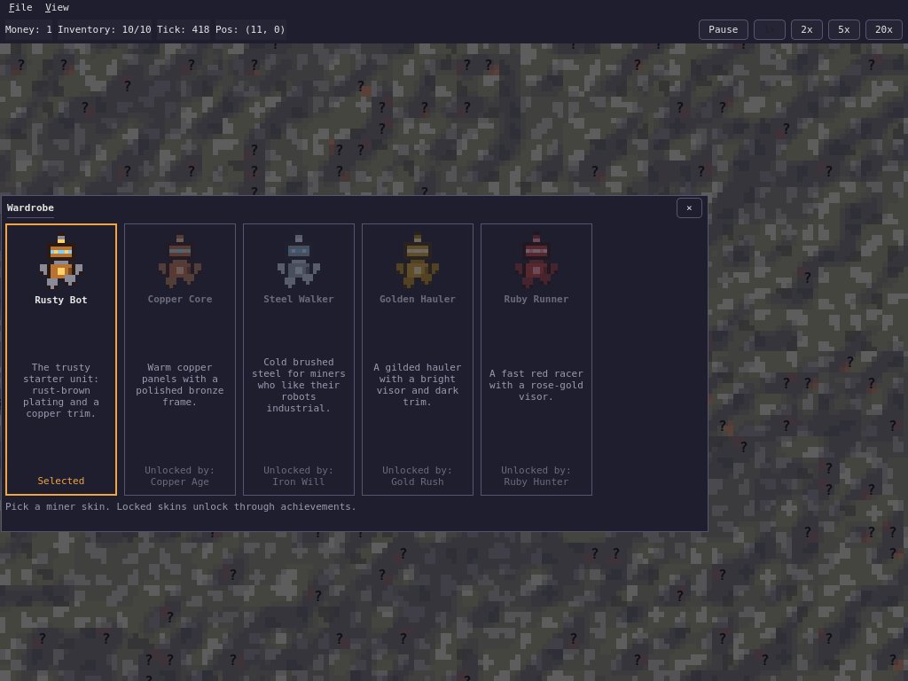

# MineSim

DigScript is an open-source 2D top-down programming game. You write real Python
in an in-game floating editor to control a mining robot on an infinite,
procedurally generated, regenerating grid. Every ore has its own mining
probability. Achievements (key **L**, like Minecraft advancements) unlock API
functions, ores, upgrades and Python modules.

## Screenshots

Lit 2.5D terrain:


Wardrobe and miner skins:



## Features

- Infinite, procedurally generated and regenerating world with biomes and
  per-ore mining probabilities.
- Lit 2.5D terrain renderer that can be toggled with `H`.
- 41 achievements in five tabs (Code, Mining, Business, Explorer, Data) that
  unlock API functions, ores, upgrades, modules and example scripts.
- Miner skins and pixel-art sprites, selected in the wardrobe panel (`K`).
- Floating script editor with syntax highlighting (`Ctrl+R` run, `Ctrl+.` stop),
  API reference, console, HUD and achievement toasts.
- 16 player API functions, the `minerlib` helper module and eight example
  scripts.
- Data-driven content, deterministic seeded worlds and save format v3 with
  autosave and v0.1.0 save migration.
- One-dir PyInstaller builds for Windows and Linux.

## Documentation

- [API reference](docs/API.md)
- [Player guide](docs/GUIDE.md)
- [Balance report](docs/BALANCE.md)

## Controls

Single-letter keys (`E F L U K H C G Space 1-5`) work while the world view has
focus. While the code editor has focus, letters are typed as code — press
`Esc` (or click the world) first, or use the **View** menu, which works
from anywhere.

| Key | Action |
|-----|--------|
| `E` / `Ctrl+E` or View menu | Toggle the script editor |
| `F` / `Ctrl+F` or View menu | Toggle the API functions panel |
| `L` / `Ctrl+L` or View menu | Toggle the achievements panel |
| `U` / `Ctrl+U` or View menu | Toggle the upgrades panel |
| `K` / `Ctrl+K` or View menu | Toggle the wardrobe panel |
| `H` or View menu | Toggle lit 2.5D terrain lighting |
| `C` | Recenter the world on the miner |
| `G` | Toggle the world grid |
| `F10` / `Alt+V` | Open the File / View menu |
| `Space` | Toggle pause |
| `1`–`5` | Set game speed (slowest to fastest) |
| `Ctrl+R` | Run the current script |
| `Ctrl+.` | Stop the running script |
| `Esc` (in editor) | Return focus to the world |

## Your first script

Open the editor with `E`, replace the starter script and press `Ctrl+R`:

```python
for _ in range(10):
    if peek() is not None:
        mine()
    move(East)
```

Run it to completion to unlock the **Hello, Miner** achievement, then sell your
ore with `sell()` and buy the **Backpack** upgrade with `buy_upgrade("backpack")`.

## Install from source

```sh
uv sync && uv run digscript
```

Linux note: `sudo apt install libxcb-cursor0`

## Safety

Player scripts run in a separate subprocess with a restricted namespace. This is
**not** a security sandbox: only run scripts you trust.
