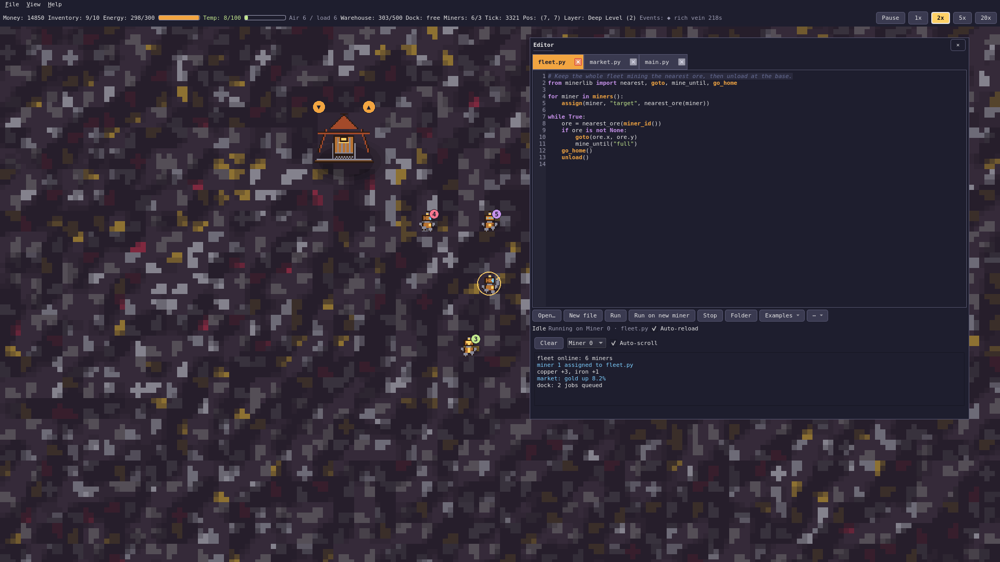
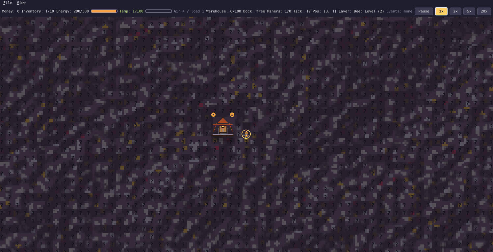
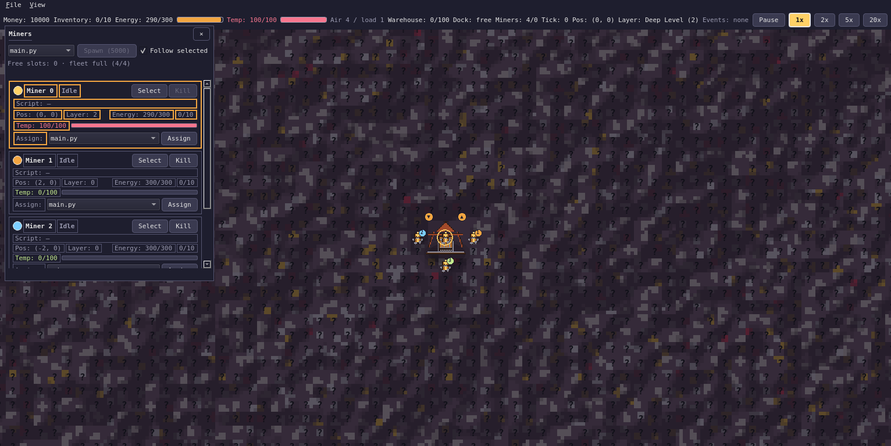
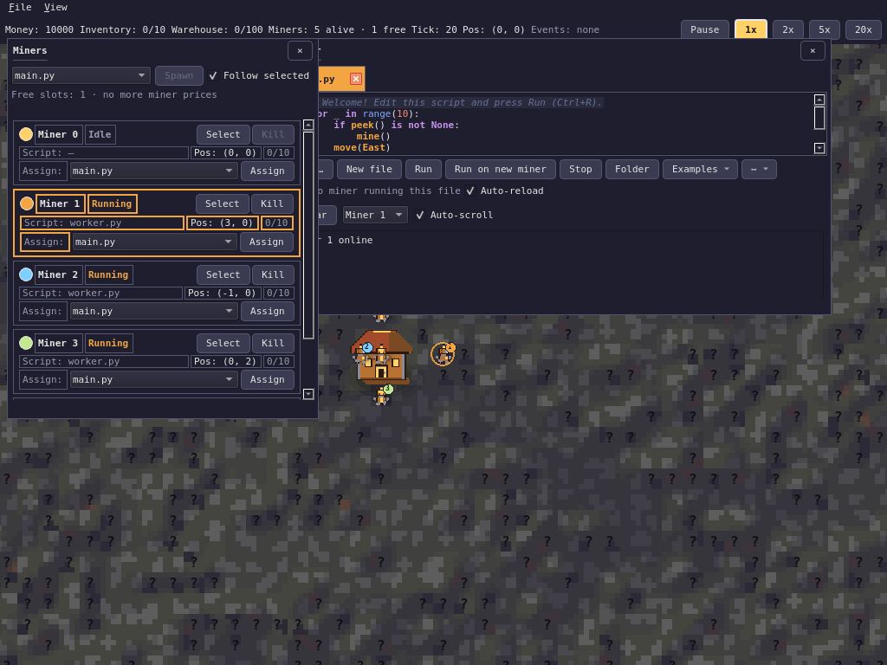
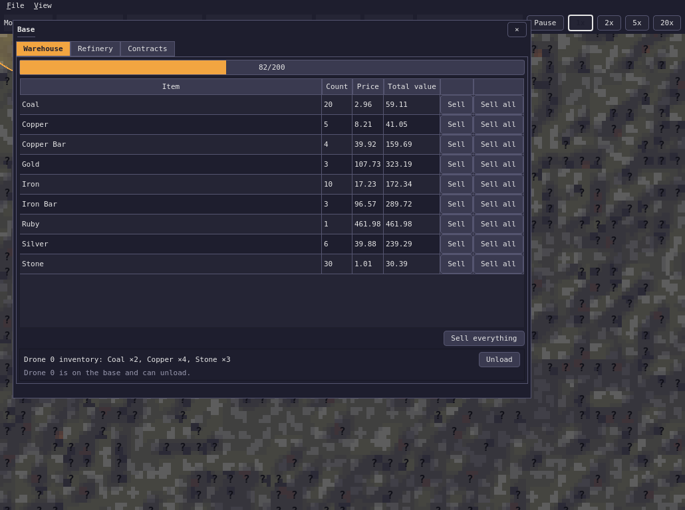
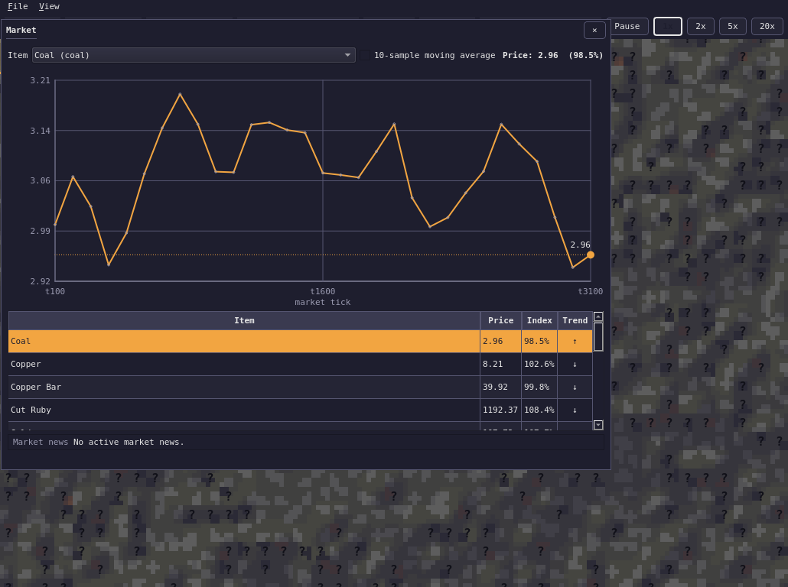

# MineSim

**Automate a mining operation by writing real Python.**



[](https://github.com/alexpr4587/MineSim/actions/workflows/ci.yml)
[](https://github.com/alexpr4587/MineSim/releases)
[](LICENSE)


MineSim is an open-source 2D top-down programming game. You write real Python in
an in-game floating editor to control a mining robot on an infinite,
procedurally generated, regenerating grid. Every ore has its own mining
probability. Achievements (key **L**, like Minecraft advancements) unlock API
functions, ores, upgrades and Python modules.

## Download

Get the latest build from the
[GitHub Releases page](https://github.com/alexpr4587/MineSim/releases).

**Windows**

1. Download `minesim-windows.zip` and unzip it.
2. Run `MineSim.exe` from the extracted folder.

**Linux**

1. Download `minesim-linux.tar.gz` and extract it.
2. Run `./MineSim` inside the extracted `minesim` folder.
3. If Qt reports a missing xcb library, install it once:
   `sudo apt install libxcb-cursor0`.

The game is also playable from source (see below) if you already have Python.

## Why it is fun

- You start with one miner and a tiny script, then watch your operation grow
  into a fleet that mines, unloads, refines, trades and cools itself.
- Every ore has a real probability, so planning a route is a small data problem
  that rewards experiments and better measurements.
- The code you write is ordinary Python: loops, functions, modules, classes and
  shared state, with a visible result on the next tick.

## Learn Python by playing

The game introduces programming ideas in this order:

1. Variables, function calls and the coordinate grid.
2. Lists, loops and conditions to sweep ore and return home.
3. Functions and small reusable helpers.
4. Modules such as `math`, `itertools`, `functools`, `dataclasses` and `typing`.
5. Classes, objects and shared fleet state.
6. Data work: sampling, estimating ore probabilities and watching market prices.

## Your first script

Open the editor with `E`, replace the starter script and press `Ctrl+R`:

```python
for _ in range(10):
    if peek() is not None:
        mine()
    move(East)
```

Run it to completion to unlock the **Hello, Miner** achievement, then sell your
ore with `sell()` and buy the **Backpack** upgrade with `buy_upgrade("backpack")`.

## Run from source

```sh
uv sync && uv run minesim
```

Linux note: `sudo apt install libxcb-cursor0`

## Screenshots

<details>
<summary>More screenshots</summary>

Underground layers with the shaft, its station and per-layer terrain:



The energy and climate HUD: battery, temperature and shared airflow:



Miner fleet with battery, temperature, scripts and consoles per miner:



Base panel with the warehouse, refinery and contracts:



Market chart with live prices and price history:



</details>

## Features

The short version:

- Infinite, procedurally generated and regenerating world with biomes and
  per-ore mining probabilities.
- Four underground layers with a shaft, a station on every layer and soft
  transitions.
- A fleet of miners with per-miner Python scripts and shared typed memory.
- Energy and rescue, heat and shared ventilation, and a shared dock.
- A warehouse, a dynamic market with price history and a chart, a refinery
  with six recipes and delivery contracts.
- World events, a lit 2.5D terrain renderer and miner skins.
- 86 achievements in ten tabs that unlock 47 player API functions, 24 example scripts,
  upgrades, modules and recipes.
- A floating editor with tabs, autosave, a console, an API reference and fleet
  consoles.
- Data-driven content, deterministic seeded worlds, save format v13 with
  autosave and migration, and one-dir Windows/Linux builds.

The long version is in [docs/FEATURES.md](docs/FEATURES.md).

## Documentation

- [Full feature list](docs/FEATURES.md)
- [API reference](docs/API.md)
- [Achievement guide](docs/GUIDE.md)
- [Progression counters](docs/PROGRESSION.md)
- [Balance report](docs/BALANCE.md)
- [Press kit](docs/press/press-kit.md)

## Controls

Single-letter keys (`E F L U K B M T H C G Space 1-5`) work while the world
view has focus. While the code editor has focus, letters are typed as code —
press `Esc` (or click the world) first, or use the **View** menu, which works
from anywhere. Use `PageUp` and `PageDown` in the world to look at the layer
above or below. In the editor, use the tab close buttons, middle-click, `Ctrl+W`
or `Ctrl+Shift+T` to manage scripts; the `⋯` menu renames, duplicates, deletes
and restores files.

| Key | Action |
|-----|--------|
| `E` / `Ctrl+E` or View menu | Toggle the script editor |
| `F` / `Ctrl+F` or View menu | Toggle the API functions panel |
| `L` / `Ctrl+L` or View menu | Toggle the achievements panel |
| `U` / `Ctrl+U` or View menu | Toggle the upgrades panel |
| `K` / `Ctrl+K` or View menu | Toggle the wardrobe panel |
| `B` / `Ctrl+B` or View menu | Toggle the base panel (warehouse, refinery, contracts) |
| `M` / `Ctrl+M` or View menu | Toggle the market panel and price chart |
| `T` / `Ctrl+T` or View menu | Toggle the miners panel and fleet view |
| `H` or View menu | Toggle lit 2.5D terrain lighting |
| `PageUp` / `PageDown` | View the layer above / below |
| `C` | Recenter the world on the miner |
| `G` | Toggle the world grid |
| `F10` / `Alt+V` | Open the File / View menu |
| `Space` | Toggle pause |
| `1`–`5` | Set game speed (slowest to fastest) |
| `Ctrl+R` | Run the current script |
| `Ctrl+.` | Stop the running script |
| `Ctrl+W` | Close the current editor tab (file is kept) |
| `Ctrl+Shift+T` | Reopen the last closed editor tab |
| `Esc` (in editor) | Return focus to the world |

## Roadmap

- **v0.5 (in progress):** code-synthesized sound and music, cozy ambience,
  always-visible goals, a first-game guide, script feedback, showcase tools and
  more achievements and skins.
- **Later:** freight trains on a schedule, heavy machinery with fuel, water and
  pumps, per-layer events, a minimap and weekly challenges on a shared seed.

## Feedback

Use the in-game **Help** menu or open an issue:

- [Report a bug](https://github.com/alexpr4587/MineSim/issues/new?template=bug_report.md)
- [Request a feature](https://github.com/alexpr4587/MineSim/issues/new?template=feature_request.md)
- [Send feedback](https://github.com/alexpr4587/MineSim/issues/new?template=feedback.md)

## License

MineSim is released under the [MIT License](LICENSE).

Player scripts run in a separate subprocess with a restricted namespace. This is
**not** a security sandbox: only run scripts you trust.
