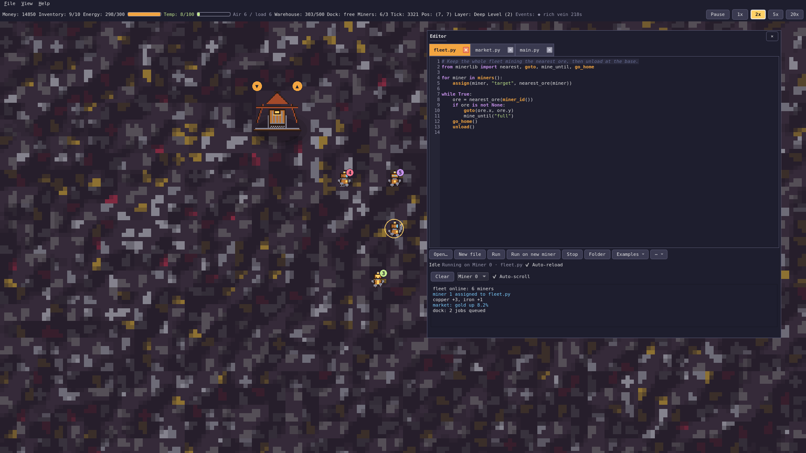
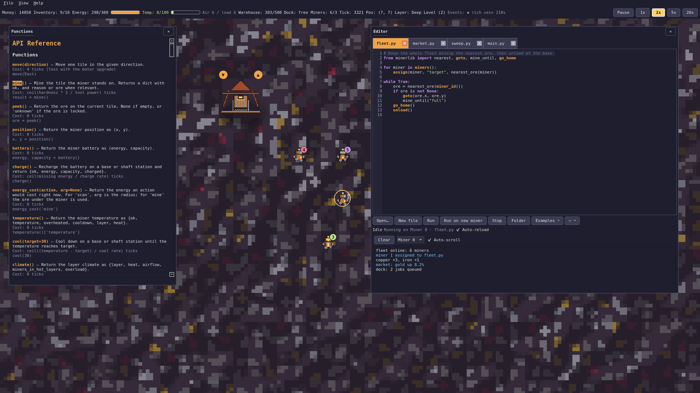
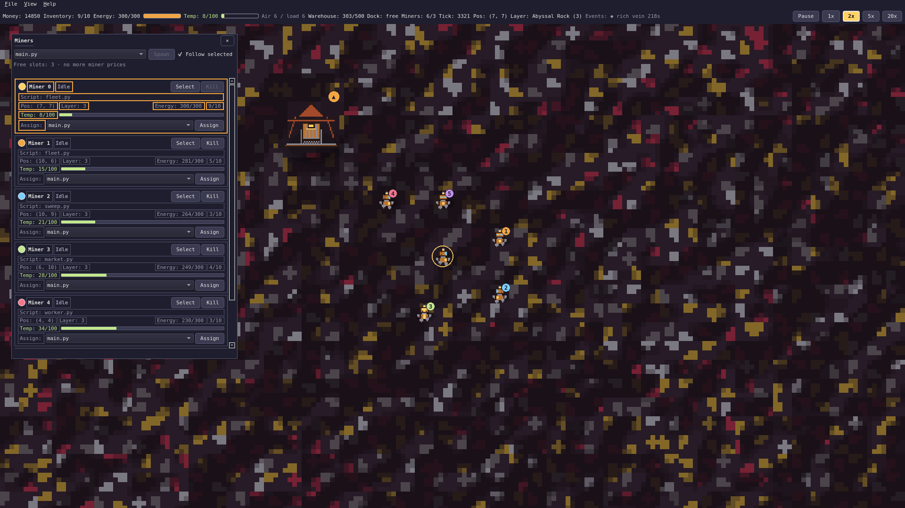
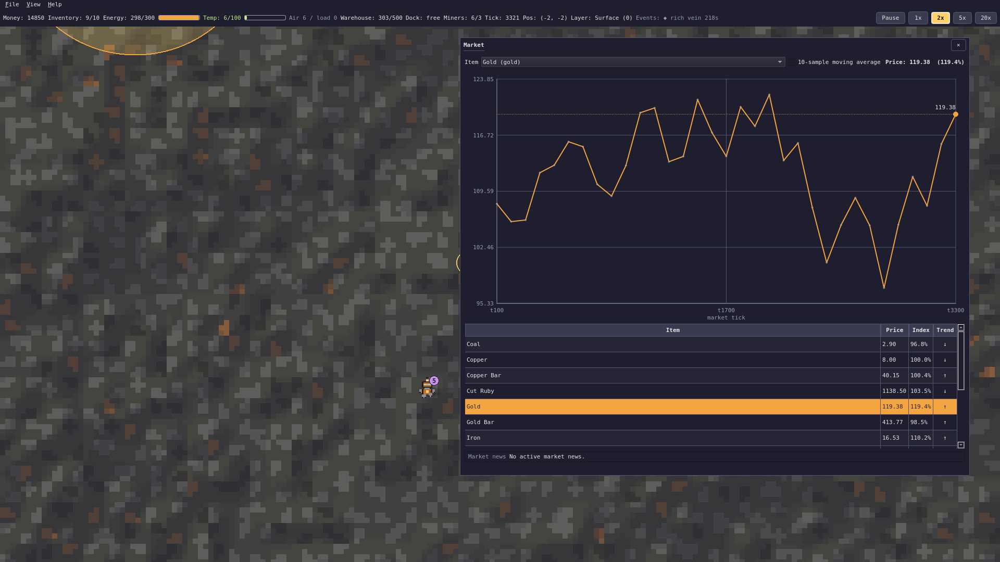
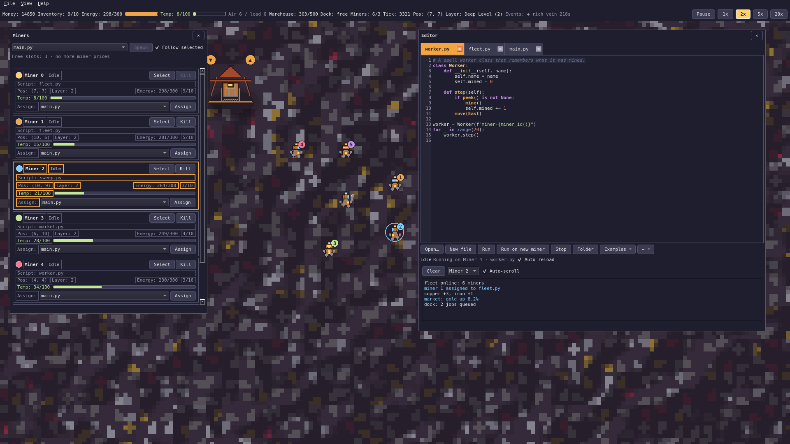
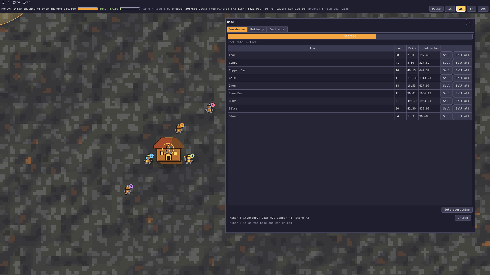

# MineSim press kit

## Short description

MineSim is an open-source 2D top-down programming game. You write real Python
to automate a mining operation on an infinite, procedurally generated grid.

## Long description

MineSim puts a real Python editor inside a small mining game. You start with one
miner, a battery and a script. Every ore has its own mining probability, and
every layer has its own heat, light and hazards. As you play, achievements
unlock API functions, Python modules, ores, upgrades, recipes and example
scripts.

The game is a sandbox for ordinary Python: loops, functions, lists, modules,
classes and shared state. A fleet of miners can run separate scripts and
coordinate through typed shared memory. The base adds a warehouse, a refinery
and delivery contracts, while the market turns ore into money with live prices
and price history.

MineSim runs on Windows and Linux, ships as a one-directory build, and is
released under the MIT license. Player scripts run in a separate subprocess
with a restricted namespace. This is **not** a security sandbox: only run
scripts you trust.

## Feature bullets

1. Write real Python in a floating in-game editor with tabs, autosave and a
   console.
2. Infinite, seeded, regenerating world with biomes and per-ore mining
   probabilities.
3. Four underground layers connected by a shaft, with a station on every layer.
4. A fleet of miners with per-miner scripts and typed shared memory.
5. Batteries, rescue towing, heat and shared ventilation.
6. Warehouse, dynamic market, price chart, six refinery recipes and delivery
   contracts.
7. 86 achievements in ten tabs that unlock API functions, modules and content.
8. Lit 2.5D terrain, miner skins, world events and one-dir Windows/Linux builds.

## Screenshots

| Image | What it shows |
|-------|----------------|
| `hero.png` | The fleet at the base with the editor, fleet panel and HUD. |
| `hero-vertical.png` | The same scene in a 1080x1920 portrait crop. |
| `editor.png` | The script editor, API reference and console. |
| `editor-vertical.png` | The editor and API reference in portrait. |
| `layers.png` | An underground layer with the shaft station and miners. |
| `layers-vertical.png` | The fleet panel and underground layer in portrait. |
| `market.png` | The market panel with live prices and price history. |
| `market-vertical.png` | The market chart in portrait. |
| `miners.png` | The fleet panel, worker script and selected miner console. |
| `miners-vertical.png` | The fleet panel and editor in portrait. |
| `base.png` | The base warehouse, refinery and contracts. |
| `base-vertical.png` | The base warehouse and surface in portrait. |
| `social-preview.png` | 1280x640 social card with the title and editor. |

All press images are rendered from the real game with
`uv run python tools/screenshot.py --preset <name>` at 1920x1080 and
1080x1920. The social preview is `social-preview.png` (1280x640), generated
with `uv run python tools/social_preview.py`.

## Palette

| Role | Hex |
|------|-----|
| Background | `#1e1e2e` |
| Surface | `#2a2a3d` |
| HUD background | `#252535` |
| Accent | `#f2a541` |
| Text | `#e6e6e6` |
| Dim text | `#9a9ab0` |
| Success / cool | `#c3e88d` |
| Info / slow zone | `#7dcfff` |
| Error / hot | `#f7768e` |

The full palette lives in `src/minesim/ui/theme.py`.

## Credits

- Design, code and documentation: MineSim contributors.
- Built with Python, PySide6, pydantic, numpy and platformdirs.
- Pixel art, sprites and UI are drawn in code; there are no third-party art or
  audio assets in the repository.
- License: MIT. See `LICENSE`.
